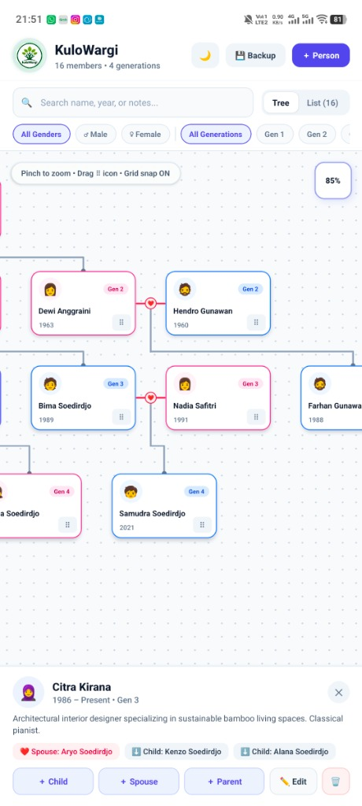
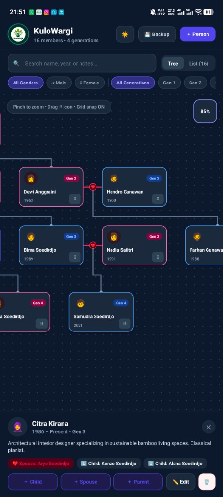
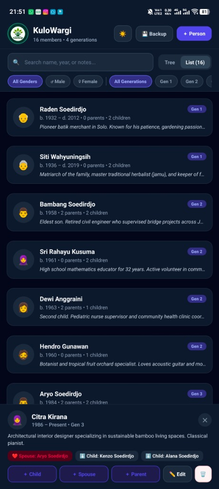
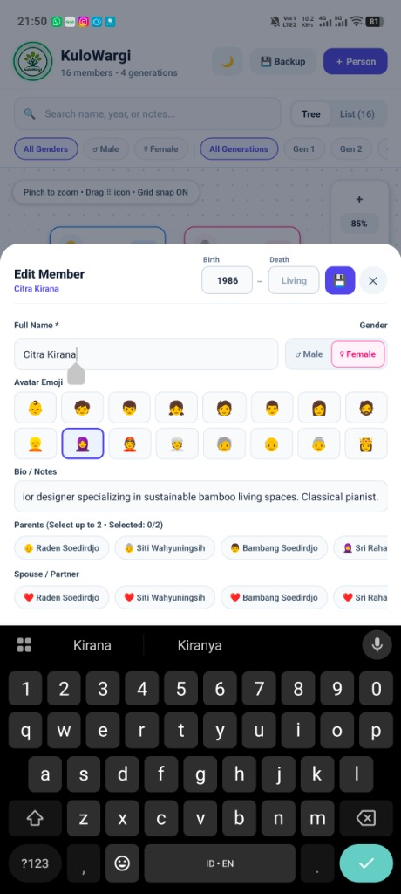
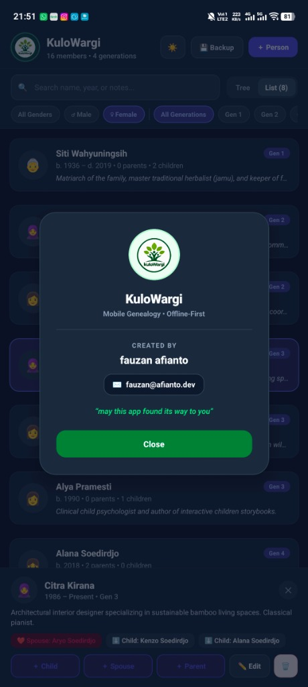

<div align="center">


# KuloWargi — Mobile Genealogy & Family Tree Canvas

**An offline-first, high-performance interactive family tree application for Android & iOS built with React Native, Expo, and TypeScript.**

[](https://reactnative.dev/)
[](https://expo.dev/)
[](https://www.typescriptlang.org/)
[](https://opensource.org/licenses/MIT)
[](https://github.com/thearticle/kulowargi-family-tree)

<p align="center">
  <a href="#key-features">Key Features</a> •
  <a href="#screenshots--ui-showcase">Screenshots</a> •
  <a href="#technical-architecture">Architecture</a> •
  <a href="#tech-stack">Tech Stack</a> •
  <a href="#getting-started">Getting Started</a> •
  <a href="#credits">Credits</a>
</p>

</div>

---

## 📖 Overview

**KuloWargi** (derived from Javanese *kulawarga*, meaning "family") is an intuitive, privacy-conscious mobile genealogy app designed to preserve, visualize, and navigate multi-generational family trees without reliance on cloud accounts or third-party servers. 

Built with **React Native** and custom **mathematical tree layout algorithms**, KuloWargi renders multi-generation lineages smoothly at 60 FPS, supporting infinite gesture panning, pinch-to-zoom, drag-and-drop card repositioning with magnetic grid-snap, and full JSON backup/restore capabilities.

---

## ✨ Key Features

- 🌳 **Interactive 2D Infinite Canvas**: Fluid pan, pinch-to-zoom (20% – 250%), and one-tap re-centering powered by a lightweight SVG viewport coordinate system.
- 📐 **Smart Symmetrical Auto-Arrange**: An intelligent generational layout engine that calculates spouse clusters, sibling gaps, and orthogonal lineage connecting lines to prevent overlaps and produce balanced diagrams.
- 🖐️ **Direct Card Manipulation & Snap-to-Grid**: Drag cards anywhere on the canvas to customize branch layouts with optional magnetic 20px grid snapping; positions persist instantly to local storage.
- 🌓 **Dynamic Theme Engine**: Full native Dark Mode and Light Mode support with high-contrast text, sleek slate card styling, and subtle interactive glow hints.
- 🔍 **Instant Directory & Search**: Real-time fuzzy filtering by name, birth/death year, gender, or specific generation level, with one-tap jump-to-node on canvas.
- 🛡️ **Offline-First & Privacy Preserving**: Zero external API dependencies, analytics, or trackers. All family records remain safely on the user's device via `AsyncStorage`.
- 💾 **Portable JSON Backup & Restore**: Effortlessly export, copy, or restore complete family data and card layouts across devices.

---

## 📱 Screenshots & UI Showcase

<div align="center">
  <table>
    <tr>
      <td align="center" width="33%"><b>1. Light Mode Tree Canvas</b></td>
      <td align="center" width="33%"><b>2. Dark Mode Tree Canvas</b></td>
      <td align="center" width="33%"><b>3. Directory & Search View</b></td>
    </tr>
    <tr>
      <td align="center"></td>
      <td align="center"></td>
      <td align="center"></td>
    </tr>
    <tr>
      <td align="center" width="33%"><b>4. Member Editor & Kinship</b></td>
      <td align="center" width="33%"><b>5. In-App Credits Dialog</b></td>
      <td align="center" width="33%"><b>6. Branded Launch Splash</b></td>
    </tr>
    <tr>
      <td align="center"></td>
      <td align="center"></td>
      <td align="center"></td>
    </tr>
  </table>
</div>

---

## 🏗️ Technical Architecture & Highlights

### 1. Symmetrical Generational Tree Layout Algorithm (`src/treeLayout.ts`)
Standard graph layout engines often fail on genealogical trees with complex spouse couplings and multi-child distribution. KuloWargi implements a bespoke multi-pass algorithm:
1. **Iterative Depth Resolution**: Resolves relative generational depths while strictly enforcing that child generation $\ge$ parent generation + 1, and spouse generations align horizontally.
2. **Spouse Clustering**: Groups partners into cohesive horizontal bounding units with symmetrical spacing (`SPOUSE_GAP = 34px`, `SIBLING_GAP = 42px`).
3. **Bi-directional Median Alignment**:
   - *Bottom-Up Pass*: Centers parents symmetrically over their collective children's midpoint.
   - *Top-Down Pass*: Balances child nodes beneath parental centroids while resolving left-to-right branch collisions.
4. **Orthogonal Edge Routing**: Connects parent units to child cards via clean step-lines routed around card bounds.

### 2. Viewport-Constrained Dot Grid (Memory Optimization)
To prevent Android Out-Of-Memory (OOM) exceptions caused by allocating large 3000×3000px bitmap backdrops, the grid background is dynamically constrained to the active viewport dimensions and transformed via matrix translation, guaranteeing constant memory consumption regardless of tree size.

### 3. Gesture Engine & State Sync
Utilizes `PanResponder` with custom Euclidean distance pinch calculations to allow simultaneous multi-touch zoom and panning without blocking child touchables or drag handles.

---

## 🛠️ Tech Stack

| Category | Technologies |
|---|---|
| **Framework** | [React Native](https://reactnative.dev/) (0.74), [Expo SDK](https://expo.dev/) (51) |
| **Language** | [TypeScript](https://www.typescriptlang.org/) (Strict typing, zero compile warnings) |
| **Vector Graphics** | [react-native-svg](https://github.com/software-mansion/react-native-svg) (Orthogonal connector lines & dot grid) |
| **Storage & Persistence** | [@react-native-async-storage/async-storage](https://github.com/react-native-async-storage/async-storage) |
| **Build & Tooling** | Android Gradle Plugin 8.x, Java 17, Hermes JS Engine |

---

## 🚀 Getting Started

### Prerequisites
- [Node.js](https://nodejs.org/) (v18 or LTS)
- [npm](https://www.npmjs.com/) or [yarn](https://yarnpkg.com/)
- [Expo CLI](https://docs.expo.dev/more/expo-cli/) (`npm install -g expo-cli`)
- [Android Studio](https://developer.android.com/studio) (for local Android emulation or device builds)

### Installation

1. **Clone the repository**:
   ```bash
   git clone https://github.com/thearticle/kulowargi-family-tree.git
   cd kulowargi-family-tree
   ```

2. **Install dependencies**:
   ```bash
   npm install
   ```

3. **Start the development server**:
   ```bash
   npx expo start
   ```

4. **Run on Android**:
   ```bash
   npx expo run:android
   ```

---

## 📂 Project Structure

```text
kulowargi-family-tree/
├── assets/                  # App icons, splash drawables, branding assets
├── docs/
│   └── screenshots/         # Showcase graphics & UI screenshots for README
├── src/
│   ├── components/
│   │   ├── BackupModal.tsx  # JSON import, export, and clipboard backup
│   │   ├── MemberModal.tsx  # Member creation, edit form & relation picker
│   │   └── TreeCanvas.tsx   # Interactive canvas, gesture handling & nodes
│   ├── sampleData.ts        # Sample 4-generation pedigree dataset
│   ├── treeLayout.ts        # Algorithmic layout calculation & edge routing
│   └── types.ts             # Data models, interfaces & relation types
├── App.tsx                  # Root navigation, filtering, theme & state coordinator
├── app.json                 # Expo configuration & permissions
├── package.json             # Dependencies & scripts
└── tsconfig.json            # TypeScript compiler configuration
```

---

## 👨‍💻 Author & Credits

Created with ❤️ by **Fauzan Afianto**
- **Email**: [fauzan@afianto.dev](mailto:fauzan@afianto.dev)
- **GitHub**: [@thearticle](https://github.com/thearticle) / [@fafianto](https://github.com/fafianto)

> *"May this app find its way to you."*

---

## 📄 License

This project is licensed under the [MIT License](LICENSE).
